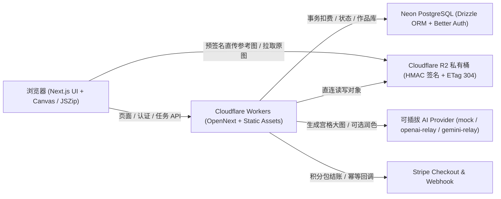

<div align="center">

<a href="https://sticker.jeremyxie.com">
  
</a>

<h1>贴纸酱 StickerJam</h1>

<p><strong>专属表情包，一次成图，轻松切图</strong><br />Turn photos or ideas into a full custom sticker pack — slice &amp; share in seconds.</p>

<p>
  <a href="https://sticker.jeremyxie.com">
    
  </a>
  <a href="https://github.com/Xiejiayun/sticker/actions/workflows/deploy.yml">
    
  </a>
  
  
  
  
</p>

<p>
  <a href="https://sticker.jeremyxie.com">🚀 在线体验</a> ·
  <a href="#-12-种精选画风">🎨 画风预览</a> ·
  <a href="#-核心特性">✨ 核心特性</a> ·
  <a href="#-技术架构">🏗️ 技术架构</a> ·
  <a href="#-快速开始">⚡ 快速开始</a> ·
  <a href="#-核心文档">📚 核心文档</a>
</p>

</div>

---

**贴纸酱（StickerJam）** 是一个基于 Next.js 15 与 Cloudflare 全栈生态构建的 AI 表情包创作工坊。上传 0~4 张参考图或直接用文字描述角色，挑选精选画风与高频聊天套组，即可一次生成 **3×3（9 张）** 或 **4×4（16 张）** 风格统一的高清表情宫格，并在浏览器端零算力消耗完成切图与多平台打包导出。

> 线上体验地址：**[https://sticker.jeremyxie.com](https://sticker.jeremyxie.com)**（新用户注册即送 20 积分，可免费体验 2 套 3×3 表情包）

## 🎨 12 种精选画风

每种画风均针对贴纸轮廓清晰度与纯色背景切分做了专项提示词调优，内置同一角色的预览插画方便选型：

<table>
  <tr>
    <td align="center" width="25%">
      <br />
      <strong>🌸 日系 Q 版手绘</strong><br />
      <sub>Chibi Hand-Drawn</sub>
    </td>
    <td align="center" width="25%">
      <br />
      <strong>🧸 3D 盲盒粘土</strong><br />
      <sub>3D Blind Box Clay</sub>
    </td>
    <td align="center" width="25%">
      <br />
      <strong>⚡ 美式粗线条卡通</strong><br />
      <sub>Retro Bold Cartoon</sub>
    </td>
    <td align="center" width="25%">
      <br />
      <strong>✨ 扁平矢量贴纸</strong><br />
      <sub>Flat Vector Sticker</sub>
    </td>
  </tr>
  <tr>
    <td align="center" width="25%">
      <br />
      <strong>🎨 治愈水彩插画</strong><br />
      <sub>Soft Watercolor</sub>
    </td>
    <td align="center" width="25%">
      <br />
      <strong>👾 复古像素风</strong><br />
      <sub>Retro Pixel Art</sub>
    </td>
    <td align="center" width="25%">
      <br />
      <strong>🤪 魔性简笔画</strong><br />
      <sub>Meme Doodle</sub>
    </td>
    <td align="center" width="25%">
      <br />
      <strong>🧶 羊毛毡毛绒</strong><br />
      <sub>Cozy Wool Felt</sub>
    </td>
  </tr>
  <tr>
    <td align="center" width="25%">
      <br />
      <strong>🖍️ 童趣蜡笔涂鸦</strong><br />
      <sub>Crayon Storybook</sub>
    </td>
    <td align="center" width="25%">
      <br />
      <strong>💫 日系动漫赛璐璐</strong><br />
      <sub>Anime Cel-Shaded</sub>
    </td>
    <td align="center" width="25%">
      <br />
      <strong>🏮 国潮水墨萌趣</strong><br />
      <sub>Guochao Ink Cute</sub>
    </td>
    <td align="center" width="25%">
      <br />
      <strong>🍬 Y2K 糖果果冻</strong><br />
      <sub>Y2K Glossy Jelly</sub>
    </td>
  </tr>
</table>

## ✨ 核心特性

### 🖌️ 创作工作台（Studio）
- **0~4 张参考图拖拽上传**：浏览器端自动压缩至 ≤1536px JPEG 并通过签名流直传私有 R2，支持按「主角人像 / 萌宠 / 服装穿搭 / 道具配饰」标注用途，也可纯文字描述生成。
- **3×3（9 张）与 4×4（16 张）宫格切换**：一次请求生成整套表情大图，内置生成耗时提示、字数计数与积分余额快捷充值引导。
- **单格自由编辑**：生成前支持切换 `无文字 / 中文 / 英文` 配文模式，并可逐格自定义动作与文案。
- **积分事务与自动退款**：采用原子条件 SQL 预扣积分（3×3 默认 10 积分，4×4 默认 15 积分），任意环节失败或中断均自动全额退还并写入账本。

### ✂️ 浏览器端切图与多平台导出（Pack Exporter）
- **成图直达切图，不二次扣费**：生成完成后直接进入「切图并下载」工作台，反复调整导出规格不额外消耗积分。
- **默认原像素忠实切格**：按共享整数边界切分宫格，默认保留原图细节与背景、不放大模糊、不额外加白边。
- **可选透明背景与贴纸白边**：折叠面板内可开启边缘连通 **Flood-Fill 透明抠图**，实时调节**背景容差（0–80）**与基于二维欧氏距离场（EDT）的抗锯齿**贴纸白边（0–24px）**。
- **多表面预览与一键打包**：支持透明网格 / 微信浅灰 / 深色聊天三种背景预览；导出支持**原像素 PNG**、**微信 240×240**、**Telegram 512×512**，可点击单张下载 PNG、打包整套 ZIP 或保存完整原图。

### 💬 5 大高频聊天主题套组

每套均内置 16 格中 / 英文动作与配文（3×3 取前 9 格，4×4 取全部 16 格）：

| 套组 | 适用场景 | 示例文案 |
| :--- | :--- | :--- |
| ☀️ **日常通用** (`Daily Essentials`) | 高频日常聊天 | 早安 · OK · 谢谢 · 哈哈哈 · 比心 · 晚安 · 喝奶茶 · 冲呀 |
| 💼 **打工人职场** (`Office Worker`) | 职场沟通与摸鱼 | 收到 · 摸鱼中 · 加班中 · 下班啦 · 续命 · 发工资 · 周五快乐 |
| 💕 **情侣撒娇** (`Couple & Love`) | 恋爱甜宠互动 | 抱抱 · 想你了 · 贴贴 · 哼！ · 亲亲 · 委屈 · 摸摸头 · 拉钩 |
| 🐾 **萌宠日常** (`Cute Pet`) | 猫狗毛孩子专属 | 干饭啦 · 暗中观察 · 求摸摸 · 困了 · 委屈巴巴 · 不是我 · 击掌 |
| 🎉 **节日祝福** (`Festive & Celebration`) | 节庆与好运祝福 | 新年快乐 · 恭喜发财 · 生日快乐 · 好运连连 · 干杯 · 谢谢老板 |

### 🌐 双语体验与 SaaS 基础设施
- **Cookie 驱动无前缀双语**：基于 `next-intl` 支持中 / 英文即时切换（无 `/zh`、`/en` URL 前缀污染），覆盖移动端折叠导航、作品库与账单明细。
- **私有 R2 媒体签名与缓存**：参考图与成品图存储在私有 R2 Bucket，通过 HMAC 签名限时访问，并支持 `ETag` / `If-None-Match` 304 条件响应，无需暴露 S3 密钥或开放公网桶。
- **可插拔 AI 与支付抽象层**：内置 `mock` / `openai-relay` / `gemini-relay` 图像 Provider、可选 LLM 提示词润色，以及 Stripe Checkout 与幂等 Webhook 闭环。
- **自动化部署流水线**：合并至 `main` 后通过 GitHub Actions 自动执行单测、OpenNext 构建、类型检查、Cloudflare Workers 部署与线上冒烟验证。

> **说明**：品牌图标源文件为 [`public/brand-icon.svg`](./public/brand-icon.svg)，同步提供浏览器页签与手机端图标。提示词强调一致角色、完整构图与干净轮廓；实际成图质量仍取决于上游图像模型，切图环节不会自动修复模型画错的内容。

## 🏗️ 技术架构



| 层级 | 技术选型 | 说明 |
| :--- | :--- | :--- |
| **前端与全栈框架** | Next.js 15 (App Router) · React 19 · TypeScript · Tailwind CSS v4 | 静态预渲染公共页 + 动态 API Routes，贴纸风硬阴影视觉体系 |
| **边缘部署与存储** | Cloudflare Workers (`@opennextjs/cloudflare`) · Cloudflare R2 | 静态页面由 Workers Assets 直出，私有 R2 零出站流量费 |
| **数据库与认证** | Neon PostgreSQL · Drizzle ORM · Better Auth | HTTP Serverless Driver 兼容 Workers，支持邮箱密码与 Google OAuth |
| **国际化 (i18n)** | `next-intl` | Cookie 驱动的中 / 英文无前缀切换，自动适配浏览器语言 |
| **本地图像处理** | HTML5 Canvas · JSZip | 纯客户端切图、Flood-Fill 抠图、EDT 抗锯齿白边与 ZIP 打包 |
| **AI 与支付** | OpenAI / Gemini 中转适配器 · Stripe SDK | 支持本地 `mock` 零成本全流程调试；一次性积分包永不过期 |

## ⚡ 快速开始

### 环境要求
- Node.js 20+（CI 使用 Node.js 24）
- 一个 [Neon PostgreSQL](https://neon.tech) 数据库连接串

### 本地运行

```bash
# 1. 安装依赖
npm install

# 2. 复制环境变量模板
cp .env.example .env.local
# 至少填入 DATABASE_URL、BETTER_AUTH_SECRET 与 R2_SIGNING_SECRET（详见 docs/RESOURCES_AND_SETUP.md）
# 默认 AI_IMAGE_PROVIDER=mock，无需配置 AI Key 即可零成本跑通完整生成与切图流程

# 3. 推送数据库 Schema
npm run db:push

# 4. 启动本地开发服务器
npm run dev
```

打开 `http://localhost:3000` 即可开始体验。

### 常用命令与验证

| 命令 | 用途 |
| :--- | :--- |
| `npm run typecheck` | TypeScript 全局类型检查（`tsc --noEmit`） |
| `node --test tests/*.test.mjs` | 运行全部回归单测（生成/退款、宫格边界、提示词约束、R2 签名与 304、参考图与 UUID 校验） |
| `npm run test:product` | 单独验证宫格整数边界与提示词约束 |
| `npm run test:slicer` | 启动本地浏览器切图回归页（使用合成图，不调用 AI 或生产接口），验证 7 项 Canvas / PNG / ZIP 检查 |
| `npm run cf:build` | 构建 OpenNext Worker 与中 / 英文静态公共页 |
| `npm run verify:deployment` | 验证已部署站点的页面、API 与匿名鉴权行为 |

## 📁 项目结构

```text
.
├── .github/workflows/deploy.yml   # main 分支自动测试、构建并部署至 Cloudflare Workers
├── cloudflare/                    # Workers 入口、静态路由白名单与私有 R2 签名媒体处理
├── docs/                          # 架构设计、资源配置、Cloudflare 部署与 R2 存储文档
├── public/                        # 品牌图标与 12 张画风预览插画 (public/styles/*.png)
├── scripts/                       # 静态页准备、切图回归服务、部署验收与历史数据清理脚本
├── src/
│   ├── app/                       # Next.js App Router 页面 ([locale]/*) 与 API Routes (api/*)
│   ├── components/                # Studio、PackExporter、PacksGallery、Pricing、Auth 与导航组件
│   ├── config/                    # 品牌、12 种画风、5 大主题套组与积分套餐配置
│   ├── db/                        # Drizzle PostgreSQL Schema 与数据库连接
│   ├── i18n/ & messages/          # next-intl 无前缀路由配置与中 / 英文词条
│   └── lib/                       # AI Provider、Prompt 构建/润色、Canvas 切图引擎、积分与 R2 签名
└── tests/                         # Node 回归测试与浏览器切图回归用例
```

## 📚 核心文档

- 📐 **[架构设计与开发规划方案 (`docs/DESIGN_PLAN.md`)](./docs/DESIGN_PLAN.md)** — 产品约束、系统架构、数据库 Schema 与切图算法说明
- 🔑 **[外部资源与配置指南 (`docs/RESOURCES_AND_SETUP.md`)](./docs/RESOURCES_AND_SETUP.md)** — Neon、Better Auth、Cloudflare R2、AI 中转、Google OAuth 与 Stripe 配置步骤
- ☁️ **[Cloudflare 部署与运行说明 (`docs/CLOUDFLARE_DEPLOYMENT.md`)](./docs/CLOUDFLARE_DEPLOYMENT.md)** — GitHub Actions 自动发布、本地发布、静态路由与 Free 套餐限制
- 🖼️ **[R2 私有存储与数据清理恢复 (`docs/R2_STORAGE.md`)](./docs/R2_STORAGE.md)** — 签名上传/读取数据流、安全策略与备份恢复流程
