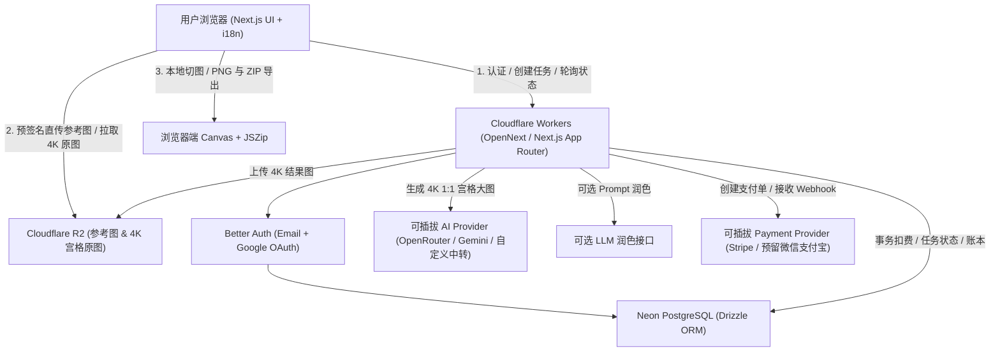

# AI 4K 表情包生成 SaaS — 架构设计与开发规划方案

> 本文档记录了 贴纸酱 / StickerJam（4K 1:1 表情包生成 SaaS 网站）的完整产品约束、系统架构、数据库设计、浏览器端切图算法、可插拔抽象层及实施路线图。

---

## 1. 系统架构总览

采用 **全 Cloudflare 免费生态 + Neon Postgres + 浏览器端 4K 图像处理** 架构，彻底规避 Cloudflare Workers 无法运行 `sharp` 及 10ms CPU / 128MB 内存限制，同时享有 R2 零出站流量费与实时可视化抠图体验。

### 技术栈清单

| 层级 | 选型 | 说明 |
| :--- | :--- | :--- |
| **全栈框架** | Next.js 15 (App Router) + TypeScript | 前后端一体，支持 SSR 与 API Routes |
| **部署运行时** | Cloudflare Workers (`@opennextjs/cloudflare`) | 每日 10 万次免费请求，无 `fetch()` 等待超时 |
| **UI 与样式** | Tailwind CSS v4 + Lucide Icons | 活泼可爱的贴纸风，支持圆角卡片与硬阴影视觉体系 |
| **国际化 (i18n)** | `next-intl` | 支持中/英文切换，默认跟随浏览器语言 |
| **数据库** | Neon PostgreSQL + Drizzle ORM | Serverless Postgres（HTTP Driver 兼容 Workers），类型安全 |
| **认证** | Better Auth | 支持邮箱密码 + Google OAuth，数据全存自有 DB |
| **对象存储** | Cloudflare R2 (S3 兼容 API) | 10GB 免费存储 + 零出站流量费，支持 CORS 供浏览器 Canvas 读取 |
| **图像处理** | 浏览器端 Canvas + JSZip | 零服务端算力，默认保留原图切格，支持可选透明背景与多规格导出 |
| **支付** | Stripe Checkout + Webhook（适配器模式） | 一次性积分包（永不过期），预留微信支付 / 支付宝扩展口 |

---

## 2. 核心业务与技术流程

### 2.1 异步生成与积分事务流

1. **参考图上传（0~4 张）**：前端自动压缩为 ≤1536px JPEG → 请求 `POST /api/uploads/presign` 获取 R2 预签名 PUT URL → 浏览器直传 R2（本地未配 R2 时自动回退为 inline Data URI）。
2. **创建生成任务**：`POST /api/packs` 校验参数与登录态 → 条件 SQL 原子预扣积分（`UPDATE credit_wallets SET balance = balance - $cost WHERE user_id = $uid AND balance >= $cost`）→ 写入 `credit_ledger(HOLD)` 与 `sticker_packs(PENDING)`。
3. **请求内生图**：保持 HTTP 请求连接，执行可选 LLM 润色 → 组装宫格 Prompt → 调用 AI Provider → 上传结果图到 R2 并更新为 `COMPLETED`，随后返回 `201`。AI 请求最长五分钟；生成期间保持页面打开。Cloudflare 的 `after()/waitUntil()` 在响应结束后只有 30 秒，不能用于这类长任务。线上继续使用 OpenAI `gpt-image-2.5-flare`、2048×2048。
4. **失败自动退款**：任意环节失败均记录 `errorMessage`、更新为 `FAILED`，并原子调用 `addCredits(..., "REFUND")` 全额退还积分。

### 2.2 成图后切图与下载 (`src/lib/slicer/sticker-processor.ts`)

1. **完成引导**：生成完成后显示原图与“切图并下载”主操作，明确切图和下载不再消耗积分。只有选择“创作新的一套”才返回生成表单。
2. **原像素网格切分**：按 3×3 或 4×4 的共享整数边界切格，完整覆盖原图。默认不去背景、不重排、不添加白边。2048px 的 3×3 单格边长为 682 或 683px，4×4 为 512px。
3. **可选透明背景**：在折叠选项中启用边缘连通 Flood-Fill；不添加白边。浅色衣物、毛发等细节仍需用户检查。
4. **PNG / ZIP 导出**：推荐原像素 PNG，也提供微信 240×240、Telegram 512×512 尺寸，支持单张、整套 ZIP 和宫格原图下载。
5. **生成约束**：提示词要求每格人物与文案完整、统一比例、10% 安全边距、无白色描边/光晕/底板。模型实际输出仍需抽样验收，提示词不能保证零瑕疵。

---

## 3. 限定内容体系（Config-Driven）

- **7 种锁定画风**（`src/config/styles.ts`）：日系 Q 版手绘、3D 盲盒粘土、美式粗线条卡通、扁平矢量贴纸、治愈水彩插画、复古像素风、魔性简笔画。
- **5 大高频主题套组**（`src/config/themes.ts`）：日常通用、打工人职场、情侣撒娇、萌宠日常、节日祝福（每套内置 16 格中/英文动作与配文，支持 `无文字 / 中文 / 英文` 切换及单格文案微调）。

---

## 4. 数据库 Schema（Neon PostgreSQL + Drizzle ORM）

完整定义见 `src/db/schema.ts`：
- **Better Auth 核心表**：`user`、`session`、`account`、`verification`
- **积分与账本**：`credit_wallets`、`credit_ledger`（`SIGNUP_BONUS` / `PURCHASE` / `HOLD` / `REFUND`）
- **支付与套餐**：`credit_packages`、`payment_orders`（通过 `PENDING -> PAID` 状态机保证 Webhook 幂等）
- **表情包任务**：`sticker_packs`（任务状态、画风/套组/网格配置快照、参考图 keys、最终 Prompt、4K 原图 R2 key）

---

## 5. 实施里程碑（全部已完成）

- **Milestone 1**：Next.js 15 + Cloudflare OpenNext + Neon Drizzle + Better Auth + R2 + `next-intl` 脚手架与基础设施。
- **Milestone 2**：Studio 创作工作台（0~4 张参考图上传与用途标注、7 种画风、3×3 / 4×4、套组与单格文案微调）。
- **Milestone 3**：Prompt 组装器、可选 LLM 润色、可插拔 AI Provider（`mock` / `openai-relay` / `gemini-relay`）与异步任务/退款 API。
- **Milestone 4**：浏览器端原像素切图、可选 Flood-Fill 透明背景与原图/微信/Telegram 多规格 PNG/ZIP 导出。
- **Milestone 5**：个人作品库、Stripe 积分包结账与幂等 Webhook 闭环。
