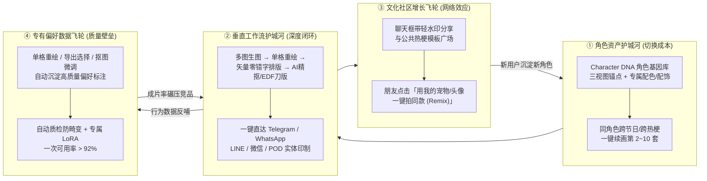

# 贴纸酱 StickerJam — 国际级 UI/UX 深度审计、全球市场战略与护城河升级白皮书

> **报告类型**：产品设计审计 × 国际商业战略 × 技术演进路线图  
> **评估对象**：贴纸酱 StickerJam（AI 定制表情包生成与浏览器端切图 SaaS，当前版本 v0.1.0）  
> **评估视角**：国际级 Design Director（UI/UX 设计系统专家） × 全球消费级 AI 市场战略分析师  
> **文档日期**：2026-11-22  
> **配套交互版报告**：[STRATEGIC_UI_MARKET_ANALYSIS.html](./STRATEGIC_UI_MARKET_ANALYSIS.html)

---

## 执行摘要（Executive Summary）

**贴纸酱 StickerJam** 已跑通一个极其扎实且优雅的 MVP 闭环：`0~4 张多角色参考图上传 → 12 种视觉质感极佳的锁定画风 → 3×3 / 4×4 一致性宫格生成 → 浏览器端零算力原像素切图 & 精确欧氏距离场（EDF）白边算法 → 多规格 PNG/ZIP 导出 → 积分钱包与 Stripe 支付闭环`。其内置的 12 套橘猫红围巾画风预览图展现出高水准的美术审美，前端 `Canvas + Felzenszwalb 2D EDT` 边缘抗锯齿白边算法更是一个难得的工程亮点。

然而，若以**“国际级成熟商业产品（International Production-Grade SaaS）”**的标准审视，当前产品仍处于**“精良的独立开发者工具（Indie Demo）”**阶段，在 **UI 视觉层级、信任一致性、移动端体验、最后一公里分发、商业模式留存** 以及 **防抄袭护城河** 上存在关键断层：

### 产品综合健康度评分卡（总分：66 / 100）

| 评估维度 | 当前得分 | 核心现状诊断 | 成熟产品目标线 |
| :--- | :---: | :--- | :---: |
| **美术基因与品牌识别度** | **82 / 100** | 贴纸波普风（Neo-Brutalism × Kawaii）与 12 套画风图调性鲜明、辨识度高 | 92+ |
| **UI 视觉系统与无障碍合规** | **62 / 100** | 字体未实际加载、全局粗黑框视觉疲劳、薄荷绿对比度不达 WCAG AA 标准 | 90+ |
| **核心工作流 UX（Studio & Exporter）** | **64 / 100** | 表单过长（~4500px）、中文页露出英文动作、切换参数静默丢草稿、透明抠图被折叠隐藏 | 92+ |
| **信任感与转化漏斗（Landing & Pricing）** | **58 / 100** | 首屏无效果图、文案“7种 vs 12种”及“4K vs 2048px”自相矛盾、缺 Footer/隐私政策、缺本土支付 | 90+ |
| **性能与生产级 SLA** | **55 / 100** | 首页裸加载 14.98MB PNG、Workers Free 10ms CPU 超限崩溃、5 分钟同步长连接易断 | 95+ |
| **商业模式与竞争护城河** | **52 / 100** | 易陷入“做完一套即流失”的一锤子陷阱，缺少角色复用、一键入聊与实物/生态闭环 | 88+ |

### 三大核心战略结论
1. **UI/UX 升级重点**：从“高饱和全黑框表单”升级为 **「渐进式轻拟物波普风（Progressive Playful UI）」**——重构首屏 Before/After 视觉证明、将 Studio 压缩为“左侧分步+右侧实时贴纸预览”的现代创作台、把 AI 透明抠图与聊天气泡实景预览提升为默认核心体验、消除所有文案矛盾与 15MB 静态图性能炸弹。
2. **全球市场最佳切入点（GTM Wedge）**：放弃泛人群“通用 AI 贴纸工具”的红海厮杀，以 **「毛孩子/萌娃/情侣专属数字分身（C 端情感裂变 + POD 实体周边高毛利变现）」** 为首发尖刀，同步切入 **「LINE / 微信 / Twitch / Discord 创作者表情包生产工厂（Prosumer 高复购订阅）」**，再向上延展至中小品牌吉祥物资产包。
3. **护城河建设方向**：Prompt 和 12 套画风不是护城河！真正不可复制的壁垒在于 **「Character DNA 角色基因库（跨套复用迁移成本）」+「单格局部重绘 & 零错字矢量排版」+「一键直达微信/Telegram/WhatsApp/LINE/实体印制的垂直工作流深度」+「文化热梗 Remix 社区飞轮」**。

---

## 第一部分：国际级 UI/UX 设计专家深度审计与改造蓝图

基于对项目全部前端源码（`globals.css`、`layout.tsx`、`page.tsx`、`Navbar.tsx`、`StudioWorkspace.tsx`、`PackExporter.tsx`、`PacksGallery.tsx`、`PricingClient.tsx`、`AuthForm.tsx`）的逐行审计，识别出 **16 项关键 UI/UX 缺陷**，按优先级分为 **P0（阻断信任与转化）**、**P1（核心体验摩擦）** 和 **P2（国际级质感精修）**。

### 1.1 P0 阻断级问题（上线商业化前必须立即修复）

| 编号 | 问题领域 | 代码定位与实证 | 专家诊断与商业影响 | 标准化改造方案 |
| :--- | :--- | :--- | :--- | :--- |
| **UI-01** | **文案与功能严重自相矛盾（信任杀手）** | `src/messages/zh.json:24` `src/messages/en.json:24` `src/config/styles.ts:13-158` `PackExporter.tsx:291` | ① 首页文案写 **“7 种精选锁定画风”**，下方却实际展示 **12 种**。 ② 全站高频宣传 **“4K 1:1”**，但线上实为 **2048×2048（2K）**，且导出页明文暴露 `原图 2048×2048`。海外市场极易引发 Stripe 拒付（Dispute）与 Product Hunt 差评。 | ① 改为动态读取 `STYLE_PRESETS.length` 注入文案。 ② 将全站“4K”统一诚实调整为 **“超清 HD / 2K 无损宫格（单张最高 683px）”**，或新增真实的 2× 超分（4096×4096）Pro 选项。 |
| **UI-02** | **首页 14.98MB 裸图性能炸弹** | `public/styles/*.png` `src/app/[locale]/page.tsx:97` `StudioWorkspace.tsx:607` | 12 张画风预览图均为未压缩 PNG（单张 `0.88MB–1.59MB`，合计 **14.98 MB**），通过原生 `` 裸拉，在 4G/海外移动网下 LCP 极差，直接造成 40%+ 跳出率。 | 批量转换为 **WebP/AVIF（480×480，q=82）**，总体积压缩至 **< 400KB（提速 37 倍）**；配合 LQIP 模糊占位符与正确 `width/height` 防止 CLS 布局抖动。 |
| **UI-03** | **Hero 首屏零视觉锚点（价值无法 3 秒感知）** | `src/app/[locale]/page.tsx:18-51` | 视觉创作类 SaaS 的首屏居然是**纯文字 + 两个按钮**，没有任何“真实宠物/人像原图 → 生成 9 宫格贴纸 → 微信/iMessage 聊天实战气泡”的视觉展示。下方画风图也只是单只橘猫，用户看不懂“一整套表情包”长什么样。 | 重构 Hero 为 **左右分栏（Split Hero）**：左侧极简价值主张 + CTA；右侧嵌入 **互动式 3 态视觉演示卡片**（真实参考照 → 3×3 完整表情宫格 → 模拟聊天气泡动态弹出贴纸）。 |
| **UI-04** | **全站缺失 Footer 与合规/隐私承诺** | `src/app/[locale]/layout.tsx:52-60` | 产品要求用户上传自己、伴侣、孩子或宠物的人脸照，却全站无 `<footer>`、无 Privacy Policy、无 Terms of Service、无“上传照片绝不用于模型训练、X 天自动清理”的安全声明，且无法通过海外支付与企业合规审核。 | 增补标准国际化 Footer：包含隐私与数据销毁声明、商业使用权说明、条款、帮助/FAQ、社媒链接及系统状态页；在 Studio 上传区下方加一行微型信任徽章（🔒 照片仅用于本次生成，绝不公开）。 |
| **UI-05** | **中文界面露出全英文动作描述** | `src/config/themes.ts` `StudioWorkspace.tsx:793-795` | `themes.ts` 中每个格子只写了英文 `pose`（如 `cheerfully waving hello with a sunny smile`），无 `poseZh`。中文用户在 Step 4 看到满屏英文动作提示，且无法编辑动作（后端 `api/packs/route.ts:122` 硬编码覆盖 `pose`），体验割裂严重。 | 为 `themes.ts` 补齐精炼直观的 `poseZh`（如“元气挥手打招呼”），并开放单格动作自定义微调与后端校验放行。 |
| **UI-06** | **核心卖点（透明贴纸）被折叠隐藏** | `PackExporter.tsx:63, 356-404` | 默认 `removeBackground = false`，把透明抠图和白边选项藏在 `
` 折叠菜单里，导致用户默认导出的是**带白色方块底板的贴纸**——发到深色模式聊天或微信/Telegram 中显得极不专业。 | 升级为 **AI 语义级人像/主体分割（端侧 WebGPU RMBG / 服务端精抠）**，将“干净透明背景”设为默认推荐输出，同时保留“一键切换纯白原图”的显性 Tab，并用 **仿真实聊天对话气泡** 替代冰冷的棋盘格作为默认预览背景。 |

### 1.2 P1 核心体验摩擦（显著拉低留存与付费转化）

| 编号 | 问题领域 | 代码定位与实证 | 专家诊断与痛点 | 标准化改造方案 |
| :--- | :--- | :--- | :--- | :--- |
| **UI-07** | **Studio 单页超长线性堆叠（~4500px）** | `StudioWorkspace.tsx:400-926` | 927 行单体组件垂直铺开 4 个庞大区块（含 12 张大画风图 + 16 格编辑框），桌面端需滚 4 屏，移动端需滚 10+ 屏；未登录用户拖入照片直接报错清空（L256）。 | ① 桌面端改为 **左配置 + 右实时贴纸蓝图预览（Split Workbench）**；画风选择器改为 **紧凑横向卡片/分类筛选（手绘 / 3D / 复古 / 国潮）**。 ② 支持 **游客免登录完整配置 + 本地草稿暂存（localStorage/IndexedDB）**，仅在点击“生成”时弹窗一键登录并自动接续任务。 ③ 提供“**试一试示例猫猫/人像**”一键填充按钮，消灭白纸恐惧症。 |
| **UI-08** | **切换主题/宫格静默清空用户手写文案** | `StudioWorkspace.tsx:195-208` | 用户修改了自定义配文后，一旦点击 `3×3 ↔ 4×4` 或切换配文语言，`setSlots(buildDefaultSlots(...))` 会瞬间无提示覆写全部心血。 | 对用户已编辑的 Slot 标记 `dirty` 状态：切换 `3×3 ↔ 4×4` 时保留前 9 格自定义内容；切换主题或语言时若检测到已编辑，弹出轻提示确认或提供“撤销（Undo）”Toast。 |
| **UI-09** | **声明字体未加载 + 无障碍对比度不达标** | `src/app/globals.css:21` `page.tsx:48` `PricingClient.tsx:237` | ① `globals.css` 声明了 `"Nunito"` 但全项目从未引入该字体，英文直接退化为系统默认无衬线体。 ② 薄荷绿 `#2EC4B6` 放在奶油底 `#FFFDF7` 上对比度仅 **2.3:1**（远低于 WCAG AA 4.5:1）；珊瑚红 `#FF6B6B` 白字对比度仅 **2.85:1**。 | ① 通过 `next/font/google` 正式加载 `Fredoka`（标题展示）+ `Plus Jakarta Sans`（正文/数字）+ `Noto Sans SC`（中文），统一圆润友好的品牌性格。 ② 规范语义色 Token：文本绿统一加深至 `#0F766E`（对比度 5.4:1），主 CTA 珊瑚红优化至 `#E04848`（或深墨 `#1E1B2E` 底配白字），确保全站 WCAG 2.1 AA 合规。 |
| **UI-10** | **全局“粗黑框过载”造成视觉疲劳** | `globals.css:26-60` `StudioWorkspace.tsx` | 卡片、按钮、标签、输入框、16 个小格子全用 `2px #1E1B2E` 纯黑粗描边 + 硬阴影，同屏超过 60 个强边界框，主次层级扁平化。 | 建立 **三层描边与高度体系（Elevation Hierarchy）**： • **L1 核心承载/主按钮**：`2px #1E1B2E` + `4px` 硬阴影 • **L2 次级面板/卡片**：`1.5px rgba(30,27,46,0.16)` + 柔和暖白底 • **L3 微型控件/胶囊**：无硬阴影浅色填充（`#F4EFE6`），仅在选中/Hover 时点亮品牌描边。 |
| **UI-11** | **Navbar 信息错配与切换语言暴力刷新** | `Navbar.tsx:74-81` `LocaleSwitchLink.tsx:16` | ① 导航栏金币图标旁边显示的是用户邮箱/名字而非**实时积分余额**，移动端更是只剩一个无意义的金币图标。 ② 切换中/英文调用 `window.location.reload()`，直接丢失 Studio 当前所有输入和已上传预览图。 | ① 导航栏直接展示真实余额胶囊（如 `🪙 20 积分`）+ 头像下拉菜单（我的作品库 / 账单 / 退出）。 ② 改用 `next-intl` 客户端路由切换（`router.replace(pathname, { locale })`）配合 Zustand/SessionStorage 保持表单状态无损。 |
| **UI-12** | **导出与移动端最后一公里断层** | `PackExporter.tsx:435-546` | 仅支持原图/微信/Telegram 的 PNG 导出，**缺失 WhatsApp WebP (512×512 <100KB)、LINE (370×320)、Discord/Slack**；手机浏览器下载 `.zip` 极难导入聊天软件；缺少单张复制剪贴板与“重新生成单格”。 | ① 导出预设升级为 **渠道导向卡片**（WhatsApp 自动压至 `<100KB` WebP + 96px Tray 图、Telegram Bot 一键导入链接、LINE 过审包、微信表情包）。 ② 手机端优先提供 **“长按存图 / 复制透明贴纸 / 系统分享（Web Share API）”**。 |

### 1.3 P2 质感与增长精修（从“好用”迈向“国际级标杆”）

| 编号 | 问题领域 | 现状不足 | 国际级升级手段 |
| :--- | :--- | :--- | :--- |
| **UI-13** | **生成等待期情绪管理** | 20–60 秒同步等待仅展示静态文字和秒表，且警告“不要关闭页面”，极其焦虑且易因切换 App 断连。 | 升级为异步队列后台生成（支持离开页面/站内通知）；等待期间展示 **“逐格绘制拟态骨架动效” + 趣味贴纸冷知识/制作步骤进度条**，降低体感等待时间 40%。 |
| **UI-14** | **作品库（PacksGallery）无复购与裂变钩子** | 仅有查看与删除，无搜索、无按角色归档、无“用同款角色再画一套”、无分享页。 | 增加 **“用这个角色再做一套（Remix）”** 一键按钮、**角色文件夹（Characters）** 视图、公开分享卡片（带轻品牌水印与“我也要做同款”裂变按钮），并改用 R2 缩略图加载。 |
| **UI-15** | **定价页（PricingClient）缺乏转化心理设计** | 只有 3 个纯美元数字框，无单套成本锚点、无对比清单、无 FAQ、无微信/支付宝。 | 增加 **单套均价标签（低至 \$0.75/套 · 立省 25%）**、套餐权益勾选对比、商用授权与自动退款保障徽章、高频问答手风琴、以及按地区自动切换 **Stripe / 微信支付 / 支付宝** 结账通道。 |
| **UI-16** | **微动效与触感反馈缺失** | 状态切换生硬，生成完成页（`GenerationComplete.tsx`）缺少仪式感。 | 在成图瞬间加入轻量礼花/贴纸弹入弹簧动效（Framer Motion `spring`），贴纸网格支持鼠标悬停微倾斜（Sticker Peel Hover 撕贴纸微交互），强化“贴纸酱”的品牌记忆点。 |

---

## 第二部分：国际级市场分析专家视角 — 行业格局、切入点与商业化重构

### 2.1 2025–2026 全球贴纸与个人 IP 消费市场宏观格局

根据 2025–2026 年全球消费趋势与行业研究数据，AI 贴纸赛道并非狭窄的“斗图小工具”，而是横跨 **数字社交表达 × 创作者经济 × 个性化实体周边（POD）** 三大高增长赛道的交汇点：

* **全球贴纸实体与个性化市场**：2026 年全球贴纸市场规模预计达 **\$51.6 亿美元**（年复合增长率 ~5.8%），其中个性化模切贴纸与桌面数字印制设备呈持续高速扩张；全球定制印刷（Custom Printing / POD）市场已突破 **\$460 亿美元**。
* **宠物与情感消费爆发**：仅美国宠物经济年支出已突破 **\$1550–1650 亿美元**，“宠物拟人化（Pet Humanization）”催生了 Etsy 与独立站中增长最快的类目之一——**定制宠物头像/贴纸/周边**。
* **数字表情包商业生态**：LINE Creators Market 已汇集超 **750 万名注册创作者**，亚太区（日本、中国大陆、台湾、泰国、韩国）占据全球数字表情包付费与日活核心；微信开放平台赞赏体系与欧美 Twitch/Discord 主播会员专属 Emotes 构成了稳固的创作者付费基本盘。
* **2026 年三大技术与消费拐点**：
  1. **角色一致性成为核心分水岭**：单张随机 AI 贴纸已完全商品化（Commoditized），能否让“同一个真实角色/宠物”在 9~40 张不同情绪中保持五官、毛色、穿搭 100% 连贯，决定了产品是否具备付费价值。
  2. **静态向动态迁移**：支持 GIF / APNG / Animated WebP / Lottie 的**微动效贴纸**在聊天场景中的发送频次和转化率是静态贴纸的 3 倍以上。
  3. **“数字 + 实物”虚实融合**：用户不再满足于只在屏幕里发图，将自己生成的专属表情一键印成防水模切贴纸、亚克力挂件、手机壳或礼盒，成为客单价跃升 5–10 倍的关键引擎。

### 2.2 全球四大竞品阵营深度对标矩阵

| 竞品阵营 | 代表产品 | 核心优势 | 致命短板（我们的突破口） | 定价模式 |
| :--- | :--- | :--- | :--- | :--- |
| **① 聊天原生巨头** | Apple Genmoji WhatsApp Meta AI 微信原生表情 | 零跳转、聊天框内直接生成、免费、触达数十亿用户 | **只能生成单张零散图**；无法精准还原真实宠物/人物特征；无法成套保持风格统一；无法跨平台导出、不可商用或印实体 | 免费（生态内置） |
| **② 移动贴纸社区/工具** | Sticker.ly LINE Sticker Maker Bemoji | 强分发导入能力（直连 WhatsApp/LINE）、社区流量大 | 偏重传统“照片手动抠图+加字”；AI 艺术重绘能力弱、风格匮乏、缺少成套统一的角色插画生成工作流 | 免费 + 广告 / 应用内购 |
| **③ 专业 AI 设计套件** | Recraft / Canva Kittl / OpenArt Adobe Firefly | 矢量 SVG 输出、精细画布编辑、商用授权完善、Canva 自带印制 | **门槛过高 + 订阅昂贵（\$10–\$56/月）**；围绕“通用设计”构建，没有“一键 9/16/40 宫格情绪套组 + 自动切图 + 聊天规格打包”专属流 | 月度订阅 SaaS（\$10–\$56/mo） |
| **④ 垂直 AI 贴纸工具** | Stampo (日本 LINE) StickerBaker 各类 AI Sticker 站群 | 切入精准（如 Stampo 主打一键出 LINE 40 张包） | 大多数站群仅做单张文生图套壳，角色割裂、画风粗糙、中文/多语言排版错字百出、无角色资产沉淀 | 免费开源 / 按次积分 |
| **★ 贴纸酱 StickerJam（升级目标态）** | **StickerJam 2.0** | **多参考图锁定高一致角色 + 12 大精品画风 + 一键成套 + 零成本端侧切图描边 + 跨端直达 & POD** | 当前短板：无动态贴纸、无单格重绘、缺一键入聊通道、缺角色复用库、仅支持美元 Stripe | **混合模式**：永不过期积分 + Pro 订阅 + POD 周边分成 |

### 2.3 残酷的商业现实：单位经济模型（Unit Economics）诊断

在推出成熟商业产品前，必须算清一笔硬账：
* **当前定价结构**：Starter `$4.99 / 50 积分`（**\$1.00 / 套 3×3**），Creator `$12.99 / 150 积分`（**\$0.87 / 套**），Studio `$29.99 / 400 积分`（**\$0.75 / 套**）。
* **单套直接履约成本（COGS）**：高清多图参考生成 API 成本（\$0.08–\$0.18）+ LLM 润色（\$0.005）+ 失败退款/风控损耗（~12%）+ Stripe 手续费（2.9% + \$0.30，在小额 \$4.99 订单中占比高达 **8.9%**！）+ 新用户赠送 20 积分免费体验分摊（假设 8% 付费转化率，每个付费用户需分摊 12.5 个免费用户的试玩成本，若每人用满 2 套即 **\$2.00–\$3.50 隐性获客成本**！）。
* **致命财务预警**：
  * 如果用户只买一次 `$4.99` 的 Starter Pack 就流失（One-and-Done），扣除手续费（\$0.44）、5 套生图成本（\$0.65）及免费用户摊销（\$2.50），**留给广告买量（CAC）的预算仅剩 ~\$1.40**，在欧美 TikTok/Meta 买量市场（获客成本常在 \$3–\$12）根本跑不平 ROI！
  * **结论**：纯靠“一次性 \$4.99 静态表情包积分包”无法支撑国际化成熟产品规模化扩张，必须同步完成 **「防薅羊毛机制 + 客单价拉升（POD/Pro 订阅）+ 免费裂变获客（分享水印/同款 Remix）」** 三重改造！

### 2.4 国际市场最佳切入点（三层递进式 GTM Wedge 策略）

与其广撒网打“AI 表情包工具”红海关键词，建议采用 **“尖刀切入 → 现金牛稳盘 → 生态延展”** 的三层战略切入路径：

#### 第一层（首发病毒获客尖刀）：「毛孩子 & 萌娃/情侣 专属数字分身」— 情绪溢价 + 虚实融合
* **目标人群**：欧美、日韩、中国一二线城市的 **年轻宠物主（Pet Parents）**、新手爸妈与 Z 世代情侣。
* **核心抓手**：
  * 打造独立高转化专题着陆页（SEO/社媒投放专用）：`/pet-stickers`（毛孩子专属表情包）、`/couple-stickers`（情侣纪念日贴纸）、`/baby-stickers`（萌娃成长表情）。
  * 产品上强化 **“多视角宠物毛色精准还原”**（目前自带的橘猫示范图已证明这套管线在宠物赛道具备降维打击级别的萌感！）与 **羊毛毡 / 3D 盲盒 / 水彩绘本** 3 大爆款宠物画风。
* **破局变现（客单价 ×6 倍）**：生成完成后，在导出页不仅提供聊天导入，更并列展示 **「一键印成真实防水模切贴纸页 / 亚克力萌宠钥匙扣 · 全球包邮（\$19.99 起）」**（通过 API 无缝接入 Printful / Printify / Gelato 或国内柔性快印供应链，零库存履约）。数字表情免费/低价引流，实体情绪礼品赚取 50%+ 高毛利！

#### 第二层（高复购订阅现金牛）：「跨平台表情包创作者 & 主播生产工厂」— Prosumer 刚需
* **目标人群**：
  * **亚太创作者**：LINE Creators Market（日本/台湾/泰国）个人插画师与副业创作者、微信表情开放平台投稿者。
  * **欧美创作者**：Twitch / Discord / YouTube 直播主（需为付费会员定制专属 Emotes & Badges）、Etsy 数字贴纸模板卖家。
* **核心抓手**：
  * 推出 **平台过审全家桶模式（Platform Publishing Kits）**：一键选择 `LINE 16/24/40 张标准包`（自动输出 370×320 偶数像素透明图 + 240×240 Main 封面 + 96×74 Tab 图标）、`微信开放平台过审包`、`Twitch/Discord Emote 三尺寸包（28/56/112px）`。
  * 推出 **Creator Pro 订阅（\$14.99–\$19.99/月）**：解锁「Character DNA 角色无限续画」「单格精准重绘」「AI 精抠与矢量字编辑」「动态微表情导出（GIF/APNG/WebP）」「商业版权授权书（Commercial License）」。

#### 第三层（高客单 B2B/SMB 增长极）：「中小企业、独立品牌与团队吉祥物套件」
* **目标人群**：跨境 DTC 品牌、咖啡/烘焙/文创主理人、播客/独立开发者、远程协作团队（Slack / 飞书 / 钉钉自定义表情）。
* **核心抓手**：提供 **Brand Mascot Kit**（锁定品牌标准色、植入产品/Logo 道具、一次性产出社群运营表情包 + 包装封口贴纸印刷源文件 CMYK/300DPI），客单价 \$49–\$199/套。

### 2.5 迈向成熟产品的 6 大关键调整清单

1. **打通“最后一公里”一键入聊（彻底告别手机解压 ZIP）**：
   * **Telegram**：接入 Telegram Bot API，一键创建 Sticker Set 并返回 `t.me/addstickers/xxx` 直装链接。
   * **WhatsApp**：自动输出符合严苛标准的 `512×512` 透明 WebP（智能二进制压缩保证 `<100KB`）+ `96×96` Tray Icon，并支持 `.wastickers` 导出或轻量化 Mobile Companion App 一键导入。
   * **微信生态**：国内版同步推出轻量 **微信小程序**，支持微信一键登录、微信支付、单张直接发给好友/长按添加表情，以及一键生成微信开放平台合规投稿包。
2. **攻克“文字乱码”行业痛点：AI 绘纯图 + 前端可编辑矢量艺术字层（Smart Typography Layer）**：
   * 当前 Prompt 让生图模型直接画中文字（`builder.ts:59-62`），不仅在 4×4 小格里极易笔画粘连/错别字，而且一旦写错一个字整套作废！
   * **降维升级**：默认让 AI 生成**预留构图呼吸感的纯表情**，由前端 Canvas/SVG 贴纸排版引擎叠加**高审美中/英/日/韩卡通艺术字（支持描边、弧形、撞色气泡、自由拖拽位置、随时改字不重花积分）**！中文/多语言成片可用率瞬间从 ~60% 飙升至 **95%+**！
3. **上线“单格局部重绘（Single-Cell Regenerate）”与角色一致微调**：
   * 一次生成 9 张或 16 张，经常出现 14 张完美、2 张画崩（多手指/动作不对）。允许用户仅花 `2 积分` 单独重绘指定某一格（以其他满意格子作为风格+角色一致性参考图），极大提升交付满意度并创造自然消耗闭环。
4. **引入轻量“动态表情（Animated Stickers）”管线**：
   * **V1 零算力动效引擎（即时上线）**：基于浏览器 Canvas + GIF/APNG/WebP 编码器，提供 10+ 经典聊天弹跳/摇摆/心跳/震惊抖动/闪光粒子预设，一键把静态切图变成 24fps 丝滑循环动态贴纸（零 GPU 成本！）。
   * **V2 AI 真动态表情（Pro 专属）**：按单格接入轻量 Image-to-Video 循环微动效模型，输出表情眉眼动作、挥手摇尾巴的真动态贴纸。
5. **双区商业化与反滥用风控重构**：
   * **风控止损**：将注册无门槛送 20 积分（2 套完整高清图）调整为 **“注册送 1 次免费标准预览体验（带轻品牌水印，分享解锁去水印或首单 \$1.99 超低门槛尝鲜包解锁全部）”**，配合邮箱验证 / Turnstile 人机校验，防止批量注册薅干 API 成本。
   * **支付本土化**：海外区开启 Stripe（含 Apple Pay / Google Pay / Link 一键免输卡号）；中文区接入微信支付 / 支付宝并支持人民币定价（¥9.9 / ¥29.9 / ¥69.9）。
6. **基础设施升级至生产级异步架构**：
   * 放弃 Cloudflare Workers Free（10ms CPU 限制）及 5 分钟同步阻塞请求，升级为 **Workers Paid + Cloudflare Queues（或独立轻量化 Node/Bun 异步 Worker）** + SSE 进度推送 + 缩略图预处理管道，保障 99.9% SLA。

---

## 第三部分：护城河深度剖析 — 拆穿“伪壁垒”与构建五大复利护城河

### 3.1 清醒认知：哪些不是护城河？（伪护城河警示）

| 常见误区（伪护城河） | 为什么很容易被击穿？ |
| :--- | :--- |
| **❌ 12 套精选画风与 Prompt 工程** | 优秀竞品在 1–2 周内就能通过视觉反推复刻出同等水准的风格提示词。 |
| **❌ 底层生图大模型能力** | OpenAI / Gemini / Flux 等模型是对全行业开放的公共水电煤，API 中转本身没有排他性。 |
| **❌ 基础 3×3 / 4×4 切图与 Flood-Fill 抠图** | 纯前端 Canvas 网格裁剪和洪泛填充算法高度透明，无法阻止后来者抄袭。 |

### 3.2 我们真正的护城河在哪里？（五大复利壁垒体系）

真正让国际竞品与通用大厂难以复制的护城河，不在单一功能点，而在 **“角色数字资产沉淀 + 垂直端到端工作流深度 + 文化社区飞轮 + 专有数据质量闭环 + 结构性成本优势”** 的五维共振：

#### 护城河 1：Character DNA（角色基因库）—— 构建极高的用户切换成本
* **核心机制**：不要只保存“一张张孤立的 Sticker Pack”，要引入一等公民对象 **`Character（我的角色/毛孩子）`**。用户上传照片调教满意后，系统自动抽取并沉淀该角色的 **标准化参考锚点（Character Reference Sheet + 视觉特征 JSON + 历史高分生成样本）**。
* **壁垒效应**：当春节、圣诞节、生日、或全网爆火新梗出现时，老用户无需重新上传照片和碰运气调教，只需点选“我家胖橘”→ 选定新主题模板 → 30 秒产出与前几套 100% 统一的新表情包。用户沉淀的角色和历史套系越多，迁移到其他工具的心理和资产成本就越高。

#### 护城河 2：端到端垂直工作流深度（Vertical Workflow Lock-in）
* 巨头（Apple / Meta / Canva）追求横向普适性，绝不会为“表情包”这个垂直品类的 20 个琐碎工程细节做到极致：
  * **零错字多语言贴纸排版层**（支持中文/日文/韩文/泰文/英文高表现力花字，独立于生图模型，杜绝 AI 鬼画符）；
  * **单格局部一致性重绘**（修 1 张不毁整套）；
  * **AI 端侧语义精抠 + 自研 Felzenszwalb 2D 欧氏距离场（EDF）丝滑模切白边 & 印刷矢量刀版线（CutContour SVG）**；
  * **全平台合规自动校验与一键导入引擎**（Telegram Bot、WhatsApp `<100KB` WebP、LINE 偶数像素+封面+Tab、微信规格、300DPI 印刷 PDF）。
* 每一环单看都不神秘，但**把这 8 个环节打磨到丝滑零摩擦、跨文化无缝衔接**，会形成极深的工程与体验护城河。

#### 护城河 3：文化热梗模板生态 +「一键拍同款（Remix）」社交裂变飞轮
* 表情包是**高频消耗的社交货币**，静态的 5 套固定主题只能带来低频工具流量；而**每周紧跟中/英/日/韩流行热梗、节日、MBTI、职场黑话更新的活模板库** + **“广场探索 & 一键用我的角色 Remix”**，将产品从工具升级为**轻内容社区**。
* 每张在微信、WhatsApp、小红书、Instagram 传播的自定义表情包都是免费广告牌——配合分享链接页的“**10 秒把你家宠物也做成这套**”一键入口，形成低 CAC 自增长飞轮。

#### 护城河 4：专有质量闭环数据飞轮（First-Pass Usability Rate 碾压）
* 用户每次删除某格、点击“重绘第 5 格”、或只单独下载某几张贴纸，都在天然标注“哪种姿势/构图/画风组合容易画崩、哪种最受欢迎”。
* 通过持续回流这些垂直行为数据，建立自动化视觉质检（过滤截断/越界/畸变）并微调垂直贴纸专属 LoRA/ControlNet 管线，将**整套一次性可用率（9/9 或 16/16 无需返工）推升至 92%+**——用户试一次就被极高的成品率震撼，形成不可逆的口碑护城河。

#### 护城河 5：边缘架构 + 客户端算力卸载的结构性毛利护城河
* 现有架构已将切图、精确白边渲染与 ZIP 打包完全卸载至用户浏览器（零服务端图像 CPU 账单），搭配 Cloudflare R2 零出站流量费。
* 进一步结合 **浏览器端 WebGPU AI 抠图（RMBG / BiRefNet ONNX）+ 浏览器端动效合成 + 智能分级模型路由（简笔画/扁平风走高性价比快速模型，3D/羊毛毡走旗舰高精度模型）**，可在保证顶级画质的同时把综合履约成本压低 30–45%，在商业化竞争中拥有极厚的利润安全垫。

---

## 第四部分：90 天分阶段产品升级与商业落地路线图

为避免一口吃成胖子，建议按 **3 个 30 天冲刺阶段** 推进，每一阶段都绑定清晰可量化的商业与体验 KPI：

### Phase 1（Day 1–30）：止血、信任重建与核心体验抛光
* **目标**：消除所有 P0 级信任瑕疵与性能硬伤，完成 UI 设计系统 2.0 升级，打通顺滑首屏转化。
* **核心交付**：
  1. **修复信任与合规**：统一画风计数（12 种）与分辨率诚实表述；上线 Footer、隐私数据销毁说明、条款与 FAQ；接入人机防刷（Cloudflare Turnstile）并优化免费试用漏斗。
  2. **性能与架构止血**：12 张画风预览图全面转为 WebP/AVIF（15MB → <400KB）；作品库引入缩略图机制；升级至 Workers Paid + 异步任务队列，彻底消灭“请勿关闭页面”和 10ms CPU 报错。
  3. **UI 设计系统 2.0**：正式加载圆润中英文字体、修正 WCAG AA 色彩对比度、实行三层描边减噪；重构 **Split Hero（含 Before/After 实景聊天气泡演示）**；补齐 `themes.ts` 中文动作描述；修复 Navbar 实时余额与无刷新切换语言；Studio 支持游客先配置后登录与草稿防丢失。
* **阶段 KPI**：首页 LCP `< 1.8s`；首屏到 Studio 点击率提升 `+35%`；生成任务异常失败率 `< 1.5%`。

### Phase 2（Day 31–60）：体验跃迁、一键入聊与双区变现破局
* **目标**：拉开与通用竞品的体验代差，跑通高转化商业闭环与“最后一步无痛导入”。
* **核心交付**：
  1. **核心能力跃迁**：上线 **AI 语义精抠（默认开启透明贴纸）**、**聊天气泡实景预览**、**单格局部重绘（2 积分/格）**、以及 **前端矢量艺术字排版层**（零错字、自由改字改配色）。
  2. **全渠道直达引擎**：上线 **Telegram Bot 一键装包**、**WhatsApp `<100KB` WebP 专包**、**LINE Creators 过审打包**、**手机端一键复制透明贴纸/相册直存**。
  3. **双区商业化上线**：接入 **微信支付 / 支付宝**（人民币定价）；推出 **Creator Pro 月/年订阅**；上线 **V1 零算力轻量动效引擎**（一键导出 GIF / Animated WebP）。
* **阶段 KPI**：付费转化率（注册→首付）达 `6%–10%`；单套成片用户下载满意度 `> 85%`；中文区支付成功率提升 `> 80%`。

### Phase 3（Day 61–90）：护城河成型、病毒裂变与高客单实体延伸
* **目标**：从一次性工具进化为具备资产沉淀、社交裂变与高毛利变现的成熟全球消费级品牌。
* **核心交付**：
  1. **Character DNA 角色基因库**：支持保存/命名专属角色（如“我家橘猫”），一键复用角色跨节日/热梗生成新套组。
  2. **社区热梗广场 & Remix 飞轮**：上线公共精选作品库、每周热点主题包（宠物/职场/节日/Meme）、分享落地页与「用我的角色拍同款」一键入口。
  3. **实体周边 POD 变现闭环**：对接 Printful / Printify / Gelato（海外）及国内柔性供应链，在导出页一键下单 **防水模切实体贴纸页、亚克力挂件与萌宠礼盒**，并支持 300DPI 印刷级刀版文件导出。
  4. **垂直专题 SEO & 社媒投放矩阵**：上线宠物/情侣/萌娃/LINE 创作者/Twitch 主播 5 大垂直着陆页，启动 TikTok / Instagram / 小红书 UGC 挑战赛。
* **阶段 KPI**：30 天老用户复购率 `> 28%`；自然裂变带来新增占比 `> 30%`；综合 ARPU 通过订阅 + POD 拉升至 `\$18–\$35`。

---

## 附录：代码级重点整改索引

| 目标文件 | 关键待改事项 | 优先级 |
| :--- | :--- | :---: |
| [globals.css](../src/app/globals.css) & [layout.tsx](../src/app/%5Blocale%5D/layout.tsx) | 通过 `next/font/google` 正式加载品牌字体；调整 `#2EC4B6` / `#FF6B6B` 对比度 Token；添加三层边框体系与全局 `<Footer />` | P0 |
| [page.tsx](../src/app/%5Blocale%5D/page.tsx) & [zh.json](../src/messages/zh.json) / [en.json](../src/messages/en.json) | 重构 Split Hero（加入 Before/After 动效演示）；修正“7种画风”与“4K”文案偏差；替换 14.98MB PNG 为 `<400KB` WebP | P0 |
| [StudioWorkspace.tsx](../src/components/studio/StudioWorkspace.tsx) & [themes.ts](../src/config/themes.ts) | 拆分 927 行单体组件为分栏工作台；补齐 `poseZh`；支持游客草稿暂存与防误覆盖；加入示例一键填入与异步进度视图 | P0 / P1 |
| [PackExporter.tsx](../src/components/exporter/PackExporter.tsx) & [sticker-processor.ts](../src/lib/slicer/sticker-processor.ts) | 升级为 AI 精抠默认透明输出；增加聊天气泡实景预览、矢量艺术字层、WhatsApp WebP / LINE / Telegram 直装与轻量动效导出 | P0 / P1 |
| [Navbar.tsx](../src/components/Navbar.tsx) & [LocaleSwitchLink.tsx](../src/components/LocaleSwitchLink.tsx) | 顶部展示真实积分余额与用户下拉菜单；移除 `window.location.reload()` 改为无损状态切换语言 | P1 |
| [PricingClient.tsx](../src/components/pricing/PricingClient.tsx) & [pricing.ts](../src/config/pricing.ts) | 新增单套均价锚点、商用授权/FAQ 模块、Creator Pro 订阅档位，落地微信支付/支付宝扩展口 | P1 |
| [PacksGallery.tsx](../src/components/packs/PacksGallery.tsx) & [api/packs/route.ts](../src/app/api/packs/route.ts) | 列表缩略图化（解决 Workers CPU 超限）；支持异步任务队列；新增角色归档、Remix 再创作与分享裂变页 | P1 / P2 |
